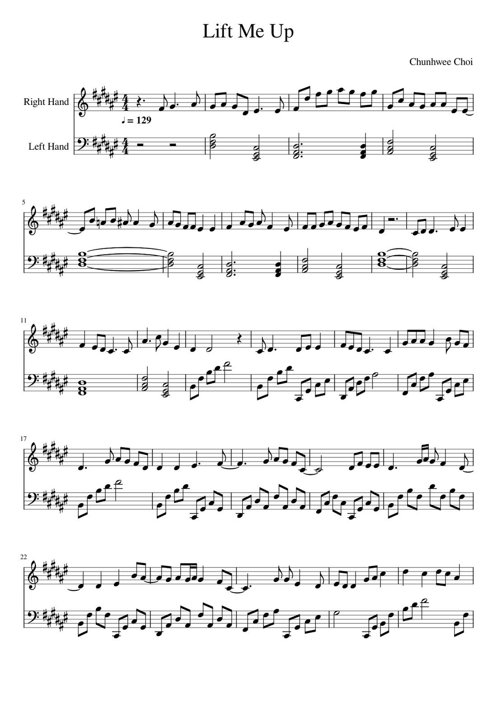

# PyScribe


PyScribe turns a song into piano sheet music you can actually play. You give it an mp3 or wav, and it gives back a two-hand piano arrangement as a MusicXML file that opens in MuseScore.

**Web app:** [chunhweechoi--pyscribe-web.modal.run](https://chunhweechoi--pyscribe-web.modal.run) if you want to try it without installing anything. A 3-minute song takes 3 to 4 minutes. It runs on free GPU credits, so it's limited to 12 songs a day, each up to 6 minutes long.



*First page of the sheet PyScribe made for "Lift Me Up", a song I wrote. The full score is in [`examples/`](examples) and was made with seed 2.*

## How it works

The melody comes from the vocal stem, the chords come from the bass and backing stems, and both hands are lined up on one beat grid taken from the recording. The pipeline runs in 12 stages, numbered the same way they show up in the log:

| Stage | What happens |
|---|---|
| 0 | Demucs (`htdemucs`) splits the song into vocals, bass, drums, and other |
| 1 | The three non-vocal stems are mixed into `accompaniment.wav` for beat tracking |
| 2 | madmom finds the beats, but it misses some in quiet parts. If the beats it did find fit one steady tempo, every beat is redrawn at that tempo, which fills the missing ones back in |
| 3-4 | CREPE (full model) tracks the vocal pitch every 10 ms, and the contour is split into notes at pitch changes and dips in vocal energy |
| 5 | Basic Pitch runs on the vocal stem to recover notes CREPE missed or scrambled, but only where someone is actually singing |
| 6 | Notes the singer was still holding get extended through fake rests |
| 7 | Vocal rests a bar or longer get filled with a melody line pulled out of the instrumental stem |
| 8 | Chroma templates pick a major or minor chord for each beat. A chord whose root matches the bass note gets a boost |
| 9 | Everything is quantized to a sixteenth-note grid, cleaned up (octave errors, vibrato trills, split notes), spelled in the detected key, and written as MusicXML with music21 |
| 10 | Left-hand chords turn into rests wherever the backing is silent |
| 11 | Drum activity decides a calm, medium, or busy left-hand texture for each section |

Every stage saves its output in `output/<song>/`, so a rerun only redoes what changed. Cached files carry a version number (`GS_VERSION`, `MEL_VERSION`, `BEAT_REPAIR_VERSION`), and a mismatch forces a rebuild.

Without a seed you get the same sheet every time, as long as the stems are cached. Separating the song again changes some notes, because Demucs shifts the audio by a random amount on every run. A seed nudges the melody timing and picks different left-hand textures, so you can make a few versions and keep the one you like.

## Design decisions

The current pipeline uses pretrained models for separation and pitch estimation, followed by rules that clean up their output.

The recording decides as much as possible. Left-hand rests come from stem energy, the texture comes from drum onsets, and stage 5 checks the vocal stem's level before it changes anything.

Nothing is tuned for one song. Every rule had to work across different songs, not just Lift Me Up.

A rough fill is better than an empty bar. If there's a melody in a vocal rest, it goes on the page even if it isn't perfect.

## What didn't work

Vibrato shows up as extra short notes, so I tried using the beat grid to clean it up: a pitch change only counted as a new note if it landed close to a beat. Set tight, it deleted real notes. Loosened, it barely did anything.

After the grid I tried two more rules to tell vibrato apart from real ornaments, and they all failed the same way. A vibrato wobble and a real ornament both go up a step and come back, so any rule that deletes one deleted the other. 

Old cached files kept getting reused after I changed the logic, so a fix wouldn't show up and I couldn't tell why. Now the cached score, melody, and beat grid each carry a version number, and a mismatch forces a rebuild.

Melodia and Basic Pitch both lost the lead melody whenever it wasn't louder than the backing. On Lift Me Up the pitch confidence stayed near zero and the line slid down to the bass. So the instrumental line only fills vocal rests, and notes below C3 are kept out of it.

## Install

You need Python 3.10 and ffmpeg (`brew install ffmpeg` on a Mac).

```bash
git clone https://github.com/Bomberman1359/PyScribe.git
cd PyScribe
python3.10 -m venv venv
source venv/bin/activate
pip install -r requirements.txt
mkdir -p data/input
```


## Usage

Put a song in `data/input/`, then:

```bash
python pipeline.py                                     # asks for the file, title, composer, and seed
python pipeline.py "data/input/song.mp3"               # default sheet
python pipeline.py "data/input/song.mp3" 7             # a variation, seed 7
python pipeline.py "data/input/song.mp3" 7 "My Song" "Me"
```

The title and composer are printed at the top of the sheet. Leave the title blank to use the file name, and leave the composer blank to leave it off.

The finished score is `output/<song>/FINAL_<song>.musicxml`. The numbered files next to it are the stages in build order.

From Python:

```python
from pipeline import run_pipeline

final_xml = run_pipeline("data/input/song.mp3", seed=None, force=False,
                        title="My Song", composer="Me")
```

Demucs and CREPE are the slow stages. Both get cached, so a rerun of the same song is quick. Both also use an NVIDIA GPU when there is one. Lift Me Up takes about 30 minutes on my laptop's CPU and 3 to 4 minutes on a T4.

The web app runs on [Modal](https://modal.com) from `modal_app.py`. A small CPU container serves the page, and songs run one at a time in a T4 container that shuts off when nothing is waiting. To host your own copy:

```bash
pip install modal
modal setup
modal deploy modal_app.py
```

## Tests

```bash
python test_passes.py
```

34 checks that run in about a second and only need numpy. They cover same-pitch merging, quantization, bar decluttering, register repair, vocal gap handling, the beat grid repair, and the title and composer written into the finished file. Each one pins down a bug I ran into while building this. GitHub runs them on every push.

## Limits

- The melody comes from the vocals, so songs without singing don't work well yet. I'm planning a separate path for instrumental songs.
- Everything is written in 4/4, and chords are major or minor triads.

## Copyright

The only audio in this repo is Lift Me Up, which I wrote. PyScribe transcribes whatever audio you give it, so only use songs you have the rights to.

## Built with

[Demucs](https://github.com/facebookresearch/demucs), [torchcrepe](https://github.com/maxrmorrison/torchcrepe), [madmom](https://github.com/CPJKU/madmom), [Basic Pitch](https://github.com/spotify/basic-pitch), [music21](https://github.com/cuthbertLab/music21), [librosa](https://librosa.org), [pretty_midi](https://github.com/craffel/pretty-midi), [Gradio](https://www.gradio.app), and [Modal](https://modal.com).

## License

MIT. See [LICENSE](LICENSE).
